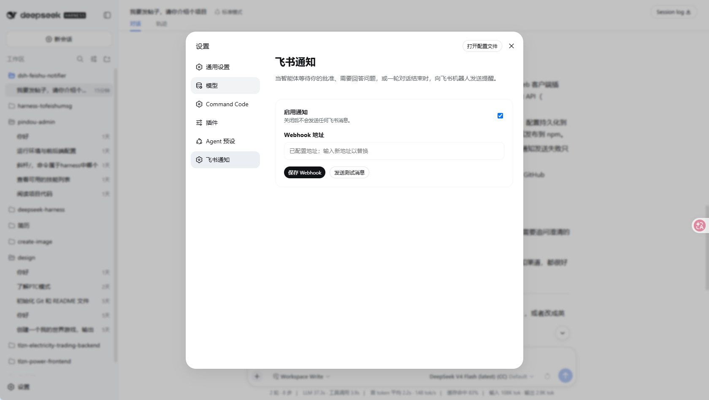
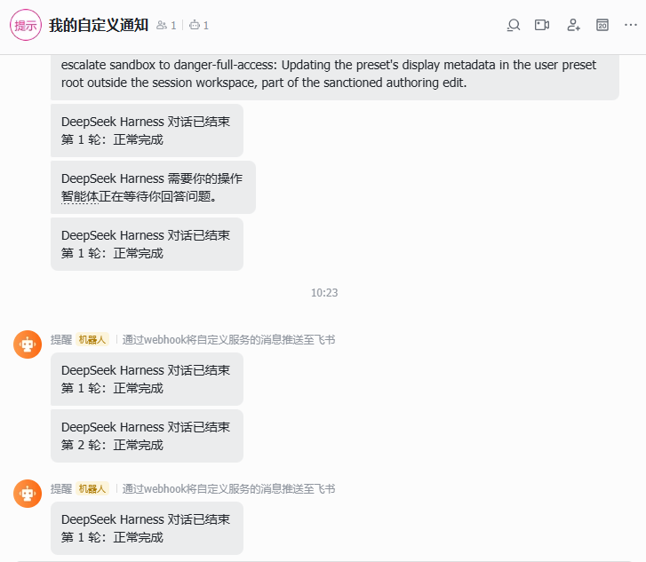

# dsh-feishu-notifier

一个 DeepSeek Harness Bundle：当智能体请求用户批准、等待用户回答问题或确认计划，以及一轮对话结束时，向飞书机器人发送卡片通知。卡片使用飞书的 `interactive` 消息类型（卡片 JSON 2.0 的 `markdown` 组件），因此支持 Markdown；轮次结束时还会附带智能体的最终输出。卡片标题会带上所属**会话名称**，便于在多个会话之间分辨通知来自哪一个。



## 使用要求

- DeepSeek Harness `0.2.0-rc.1` 或兼容版本。
- Node.js `22.19+`。
- 在 Web 设置中配置飞书自定义机器人 Webhook。


## 插件元数据

DSH 的「设置 → 插件」列表会显示每个插件的图标和中英双语的标题、描述，这些信息由 `dsh-app-boot` 在不执行插件代码的前提下读取：

- **图标**：`package.json` 的 `icon` 字段，取包内相对路径 `./icon.svg`（只允许 SVG/PNG/JPEG/WebP，且不超过 256 KiB），运行时转成 data URL 交给界面；也可以用导出子路径 `<包名>/icon` 提供。
- **标题与描述**：`locale/en.json`、`locale/zh.json` 的 `meta.title` / `meta.description`，按界面语言挑选；`package.json` 的 `name` 与 `description` 只作兜底。
- 这两类资源都要经过包的 `exports` 映射（`./locale/*.json`）与 npm `files` 白名单，漏掉任何一处，界面就会退回只显示包名。

`pnpm run smoke` 会校验图标路径、格式与体积，以及两个语言文件的 `meta` 字段是否齐全。

## 本地开发

```sh
pnpm install
pnpm run typecheck
pnpm run smoke
pnpm run build
pnpm pack:check
```

`pnpm run smoke` 会用桩上下文加载 `lib/index.js` 与 `lib/client.js`，校验通知分发、设置契约（volatile 字段与 secret 脱敏）、`settings.section` 注册，并复刻 `dsh-app-boot` 的插件版本校验、断言每个 dsh peer 范围都能接纳目标运行时版本 —— 升级 DSH 后应优先运行它，版本范围失配会在这里而非启动时报错。

构建会生成：

- `lib/index.js`：Node/Cordis Loader 入口；
- `lib/client.js`：Web 浏览器插件入口。

## 从 npm 安装

将插件发布到 npm 后，用户可以直接使用以下命令安装到 `web` Profile：

```sh
dsh plugin --profile web add dsh-feishu-notifier
dsh --profile web
```

如果使用源码方式运行 DeepSeek Harness，则将 `dsh` 替换为 `pnpm dsh`：

```sh
pnpm dsh plugin --profile web add dsh-feishu-notifier
pnpm dsh --profile web
```

启动后打开：

```text
设置 → 飞书通知
```

填写飞书机器人 Webhook，点击“保存 Webhook”，然后点击“发送测试消息”验证连接。

配置通过 DSH 的 settings 服务写入当前 Profile 的补丁文件，通常是 `~/.dsh/profiles/<profile>/cordis.patch.yml`。真实 Webhook 不会包含在 npm 包中，每位用户都需要配置自己的地址。




## 从 GitHub 安装

建议使用 release tag 或 commit SHA，确保安装内容可复现：

```sh
pnpm dsh plugin --profile demo add github:blooming-fang/dsh-feishu-notifier
```

从 GitHub 安装时会执行 `prepare` 构建插件。只应安装可信仓库中的代码；pnpm 可能要求在 Profile 的 workspace 配置中加入 `allowBuilds` 授权。

## 通知事件

插件会发送以下通知：

- 用户审批请求（`approval/request` 瀑布事件）；
- `ask_user_question` 用户问题请求；
- `exit_plan_mode` 计划确认请求；

  上面两项在两种会话形态下都会通知：普通会话记录为顶层 `tool/call`；PTC（程序化工具调用）会话的顶层调用是 `run_code`，嵌套调用记录为 `tool/ptc-dispatch-start`，插件在调用开始、提问弹出的那一刻发送通知。
- `turn/end` 对话轮次结束事件，并将完成、错误、取消、分叉和中断原因转换为可读文本，同时附带本轮最后一段可见的助手输出（推理内容与工具调用不会进入通知）。输出超过单条 3000 字的上限时不会被截断，而是拆成多条连续卡片依次发送，标题带 `（1/N）` 序号；跨卡片的代码块会自动闭合、在下一张卡片重新打开，代码不会被折断成普通文本。多条之间按飞书频控留出间隔：批次不超过 90 条时每条间隔 **300ms**（约 3.3 条/秒，低于同一群 5 条/秒的限制）；超过 90 条时自动放慢到 **670ms**（约 90 条/分钟，低于自定义机器人 100 条/分钟的上限，并留约 10% 余量）。子代理（`session.header.origin === 'subagent'`）的轮次结束不会触发通知。

消息格式：标题栏使用 `DSH` 状态短语并附上会话名称，例如「DSH 对话已结束 · 飞书通知插件添加会话名称」「DSH 需要你的操作 · 修复登录接口」。飞书的推送预览只显示卡片标题、不显示正文，所以会话名放在标题里，手机锁屏时就能直接看出是哪个会话；卡片头部也只保留这一行标题，不会出现两行标题式的重复。正文由卡片 JSON 2.0 的 `markdown` 组件渲染，标题、列表、代码块与链接都按 Markdown 显示。

会话名称取自 DSH 的会话标题服务（`@deepseek-ai/dsh-session-title`），也就是会话列表里显示的名字，会随用户重命名或自动生成的标题一起更新。插件用 `ctx.get('sessionTitle')` 可选地读取它，因此：

- 未挂载会话标题服务的部署照常加载插件，只是标题里不带会话名；
- 标题尚未生成（例如刚创建、还没产生用户消息的会话）时只显示「DSH 对话已结束」这样的状态短语；
- 读取标题失败只会退化为不带会话名的标题，不会影响通知本身。

测试消息没有所属会话，标题固定为「DSH 飞书通知测试」；带会话名的标题只出现在真实通知里。

图片：飞书卡片里的 Markdown 图片只接受由「上传图片」接口换来的 `image_key`（语法 ``），而自定义机器人 Webhook 本身没有上传能力。正文里一旦出现 `` 这样的本地路径或普通 URL，飞书会以 `200570: card contains invalid image keys` **拒收整张卡片**，整条通知就丢了。插件会在发送前改写这类图片：

- **本地图片**变成指向插件自带图片路由的超链接，例如 `[图片：预览](http://127.0.0.1:<端口>/api/feishu-notifier/image?id=...)`。在运行 DSH 的这台电脑上点击，就会用浏览器打开原图；相对路径会先按该会话的工作目录解析成绝对路径。
- **普通 URL 图片**变成直接指向该 URL 的超链接。
- 如果当前 DSH 版本没有暴露 Web 服务地址（或路由不可用），回退为行内代码形式的本地地址，例如 ``[图片：预览]（`J:\work\.tmp\a.png`）``。
- 代码块与行内代码里的图片语法保持原样，只有已经是 `img_...` 的合法 key 会原样保留。

图片路由只服务通知里实际引用过的图片：每次生成本次进程内随机且不可猜测的 id，只允许常见图片扩展名，最多保留 500 条，DSH 重启后旧链接失效。所以它不是通用文件服务器；同时这类链接只在运行 DSH 的本机可用，手机或其它电脑上打不开。

如果确实需要在通知里**直接显示**图片（而不是链接），仍需另行配置自建应用（App ID / App Secret、`im:image` 权限）把图片上传换成 `image_key`，属于后续可选增强。

以下两种情况不会发送通知：

- **用户主动停止**：轮次以 `aborted`（取消原因为 `user`）结束时保持静默，因为此时用户就在 DSH 界面旁，飞书推送只会形成干扰。由父代理、钩子或会话释放造成的取消不算用户主动停止，仍会照常通知。
- 插件被关闭（`enabled: false`）或 Webhook 为空时，所有通知都不发送。

Webhook 属于敏感设置（Config 中声明为 `role('secret')`），保存后不会返回给浏览器。不要把真实 Webhook 地址提交到 GitHub 或发布到 npm。


## 从旧版本升级

### 从 0.3.10 升级到 0.3.11

- 新增：本地图片不再以行内代码显示地址，而是变成可点击超链接，指向插件自带的本地图片路由；在运行 DSH 的电脑上点击即可用浏览器打开原图。路由用本次进程内随机 id 映射通知实际引用过的图片，仅允许图片扩展名、最多 500 条，DSH 重启后旧链接失效，不会成为通用文件服务器。
- 普通 URL 图片改为直接超链接；无法获取 Web 服务地址或旧版本 DSH 没有 `getOrigin` 时，仍回退为行内代码地址。
- `scripts/smoke.mjs` 增加图片路由注册、链接生成、按会话 cwd 解析路径，以及 HEAD 请求真实图片返回 `image/png` 的断言。
- README 更新图片说明；版本 0.3.11。

### 从 0.3.9 升级到 0.3.10

- 变更：图片降级文本追加图片地址，形如 ``[图片：预览]（`.tmp/a.png`）``；相对路径按会话工作目录解析为绝对路径（`J:\work\.tmp\a.png`），地址用行内代码包裹避免 Windows 反斜杠被 Markdown 转义；无 alt 时显示 `[图片]（地址）`，普通 URL 原样附带。
- `scripts/smoke.mjs` 增加地址输出、相对路径解析、绝对路径保留、URL 附带，以及按会话 cwd 解析地址的端到端断言。

### 从 0.3.8 升级到 0.3.9

- 修复：助手输出里含本地路径或普通 URL 的 Markdown 图片时，飞书会以 `200570: card contains invalid image keys` 拒收**整张卡片**，导致结束通知静默丢失。现在发送前会把这类图片降级为纯文本 `[图片：alt]`，通知能正常送达；代码块与行内代码中的图片语法不受影响，合法 `img_...` key 原样保留。
- `scripts/smoke.mjs` 增加降级回归：本地路径、普通 URL、无 alt、reference 风格、fenced/行内代码保护、合法 image_key 保留，以及含本地图片的轮次结束仍能发出卡片。
- README 补充飞书图片要求与降级原因；如需真正发图，需自建应用上传换 `image_key`（`im:image` 权限），作为后续增强。

### 从 0.3.7 升级到 0.3.8

- 变更：分条发送改为按飞书频控节奏发送，不再连续弹出。批次不超过 90 条时，每条之间间隔 300ms（约 3.3 条/秒，低于同一群 5 条/秒的限制）；超过 90 条时自动放慢到 670ms（约 90 条/分钟，低于自定义机器人 100 条/分钟的上限，并留约 10% 余量），因此不会因为一次长回答触发飞书限频。
- `scripts/smoke.mjs` 增加发送节奏回归：`sendIntervalFor` 在 90/91 条分界处的取值，以及真实多卡片发送的间隔断言。
- 对应的飞书限制见官方[频控策略](https://open.feishu.cn/document/server-docs/api-call-guide/frequency-control)：群机器人 Webhook 100 次/分钟、同一群 5 次/秒。

### 从 0.3.6 升级到 0.3.7

- 变更：轮次结束通知里的长输出不再截断。超过单条 3000 字时按行拆成多条卡片，依次发送；标题按 `DSH 对话已结束（2/3） · 会话名` 编号，正文只出现在对应卡片里，最后一张就是被截掉的那部分。
- 跨卡片的 Markdown 代码块会自动补上闭合围栏，并在下一张卡片用原来的围栏（含语言标记）重新打开，代码继续按代码渲染；切分点优先选换行处，单行超长时才在该行内切开，且不会切断 UTF-16 代理对（emoji 等）。
- `scripts/smoke.mjs` 增加 `splitOutput` 回归：分片上限、按行切分、超长单行、emoji、围栏闭合/重开，以及一次长轮次结束按序发出多张编号卡片并完整还原正文。
- README 与插件中英描述同步说明。

### 从 0.3.4 升级到 0.3.6

- 新增：飞书卡片的标题带上所属会话名称，例如「DSH 对话已结束 · 飞书通知插件添加会话名称」「DSH 需要你的操作 · 修复登录接口」。审批请求、提问/计划确认与轮次结束通知都会带上，便于分辨通知来自哪个会话。名称取自 DSH 会话标题服务（`@deepseek-ai/dsh-session-title`），未挂载该服务、标题尚未生成或读取失败时只是标题不带会话名，通知照常发送。
- 0.3.5 曾把会话名放在卡片头部副标题；0.3.6 改为并入标题：飞书的推送预览只显示标题，这样锁屏通知就能直接看出是哪个会话，卡片头部也只保留一行标题，避免看起来像两个标题。
- `scripts/smoke.mjs` 增加会话名称回归：标题内容、名称只出现在标题而不进入正文、头部不出现副标题、无标题服务与标题读取失败时的降级、测试消息标题固定。
- README 与插件中英描述同步说明该行为。

### 从 0.3.3 升级到 0.3.4

- 新增插件图标（`icon.svg`）：蓝色圆角磁贴 + 白色铃铛 + 琥珀色未读点，显示在「设置 → 插件」的列表行与详情卡片里。
- 新增 `locale/en.json` 与 `locale/zh.json`：标题与描述改为中英双语，中文界面显示「飞书通知」及对应描述，不再回退到包名。
- npm 包描述改为中文，并补充 `homepage`、`bugs` 字段。
- `scripts/smoke.mjs` 增加插件元数据回归：图标路径/格式/体积、`meta.title` 与 `meta.description`、以及 `exports` 和 `files` 是否覆盖这些资源。

### 从 0.3.0～0.3.2 升级到 0.3.3

- 修复（0.3.3）：PTC（程序化工具调用）会话中，`ask_user_question` / `exit_plan_mode` 借由 `run_code` 触发，会话日志里不会出现同名的顶层的 `tool/call`，因此此前**完全不会**发送「等待你回答/确认」的通知。现在同时识别 `tool/call` 与 `tool/ptc-dispatch-start`，两种会话形态都会通知。
- 修复（0.3.1）：用户主动停止（`turn/end` 的 `aborted` 原因归为 `user`）不再发送飞书通知；父代理、钩子与会话释放导致的取消仍照常通知。
- 变更（0.3.1）：通知标题由「DeepSeek Harness」精简为「DSH」。
- 变更（0.3.1）：消息类型由纯文本改为 `interactive` 卡片（卡片 JSON 2.0 的 `markdown` 组件），支持 Markdown；轮次结束的通知会附带该轮智能体的最终输出（最长 3000 字，超出部分截断）。

安装方式不变，重新执行 `dsh plugin --profile <profile> add dsh-feishu-notifier`（或指向新的 tgz 包）并重启 DSH 即可生效。

### 从 0.2.x 升级到 0.3.0（DSH 0.2.0-rc.1）

DSH `0.2.0-rc.1` 新增了插件版本校验：启动导入插件前，`dsh-app-boot` 会读取插件 `package.json` 的 `peerDependencies`，把所有 `@deepseek-ai/dsh` 与 `@deepseek-ai/dsh-*` 声明与当前运行时版本逐一比对（含预发布版本）。任一范围不匹配即拒绝加载该插件并提示 `Plugin ... is incompatible with dsh ...`。

因此本次升级是**必需的**，而不是可选的：插件 `0.2.2` 声明的 `@deepseek-ai/dsh-settings: ^0.1.7-alpha.1` 无法满足 `0.2.0-rc.1`，会在启动时被直接拒绝。`0.3.0` 的改动：

- 所有 `@deepseek-ai/dsh-*` 依赖与 peer 范围提升到 `^0.2.0-rc.1`，`@deepseek-ai/cordis` 提升到 `^4.0.4`，`@deepseek-ai/schemastery` 提升到 `^3.18.4`；
- 新增 `scripts/smoke.mjs` 版本校验回归：用 `semver` 复刻 `dsh-app-boot` 的判定逻辑，断言每个 dsh peer 范围都能接纳目标运行时版本，避免下次再出现同类静默失败；
- 面向 DSH 0.2.0-rc.1 重新构建 `lib/index.js` 与 `lib/client.js`。

插件使用的 settings、webServer、slots/configForms、session 事件与 `__ModuleLoader__` 客户端契约在 0.2.0-rc.1 中均未发生破坏性变化，因此业务代码无需改动。

### 从 0.1.x 升级到 0.2.x（DSH 0.1.7-alpha.1）

DSH `0.1.7-alpha.1` 用 settings 服务的配置表单取代了旧的 `ctx.settings.register` scope API：

- 配置项改为 `volatile` 字段，设置服务就地更新，插件无需重新挂载即可读到最新值；
- 浏览器端改用 `ctx.configForms` 读写命名空间 `feishu-notifier`，Webhook 仍为只写字段；
- 测试消息仍由插件自己的 Host 路由 `POST /api/feishu-notifier/test` 发送；
- `@deepseek-ai/schemastery` 改为直接依赖：`.volatile()` 需要 `>=3.18.3`，而 Profile 使用 `nodeLinker: hoisted` + `autoInstallPeers: false`，peer 依赖不会被安装。

升级后如果旧的 `~/.dsh/settings.yaml` 已迁移为 `settings.yaml.imported`，请打开“设置 → 飞书通知”重新填写一次 Webhook。
